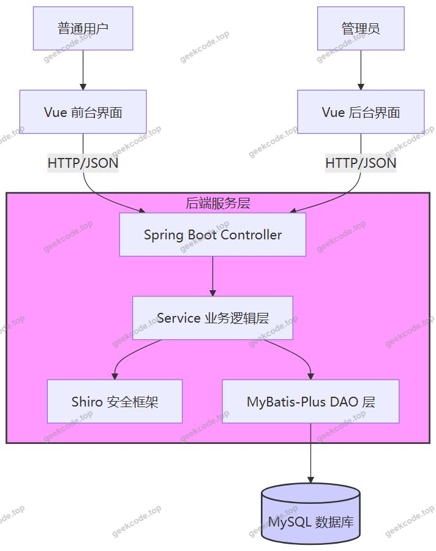
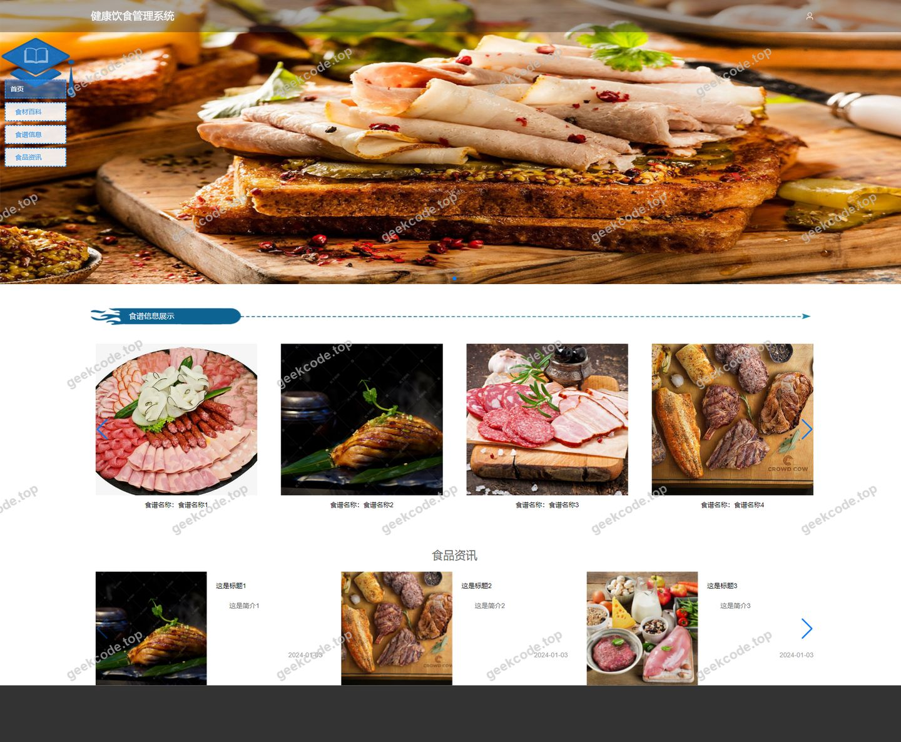
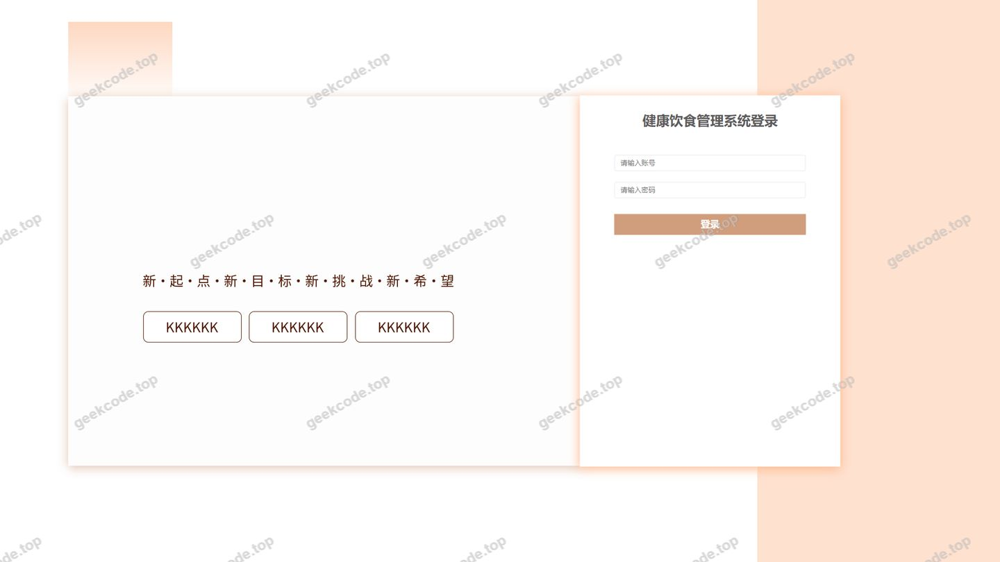
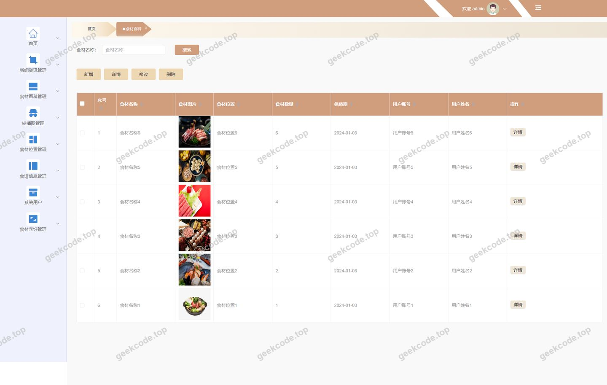
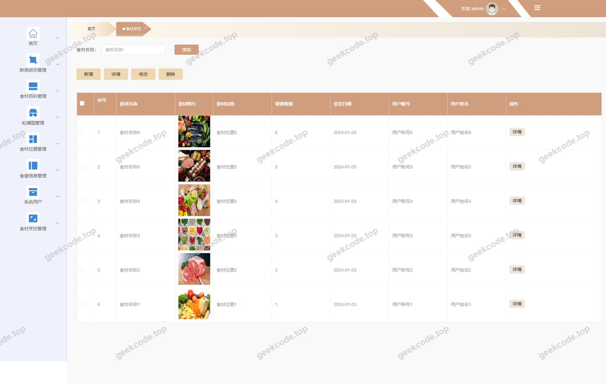
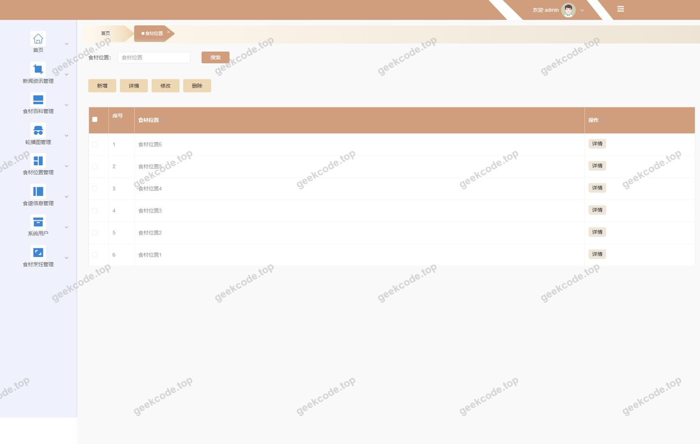
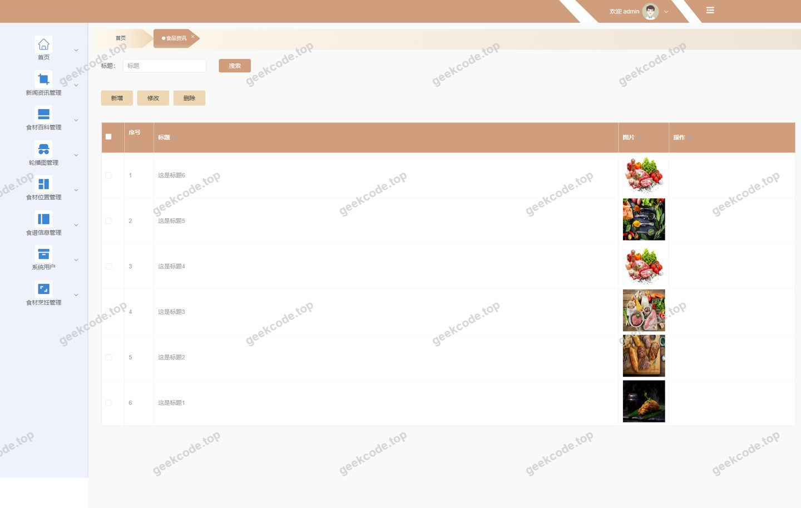
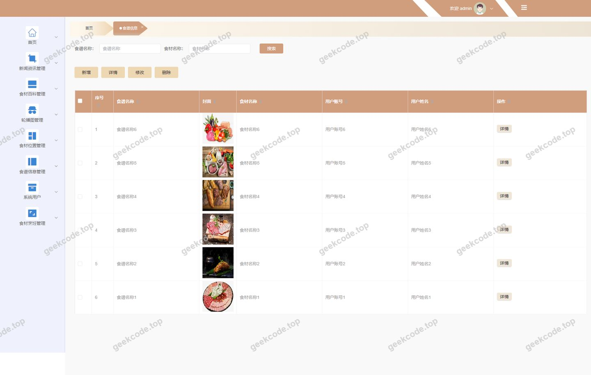
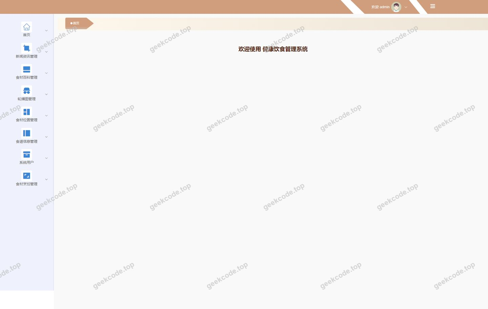
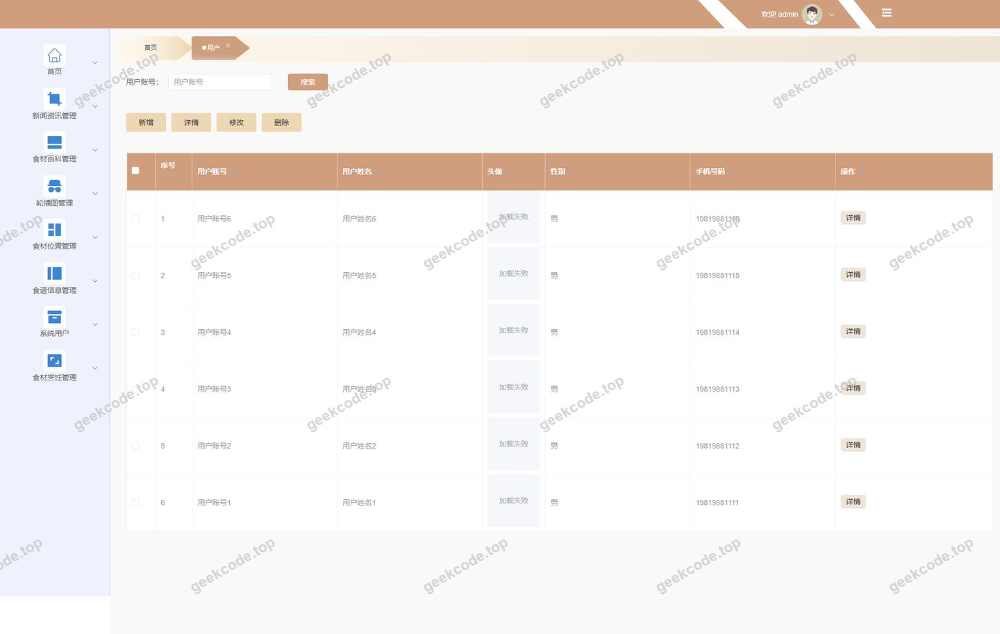

# springboot + vue 健康饮食管理系统

> 🎓 **计算机毕业设计 · springboot + vue 健康饮食管理系统**
>
> 本仓库只放**项目介绍 + 运行截图**（截图是站点带水印的原图，存在仓库 `images/` 里）。
>
> 👉 **完整可运行源码 / 数据库脚本 / 部署文档：[点我获取](https://geekcode.top/archives/springboot-vue-%E5%81%A5%E5%BA%B7%E9%A5%AE%E9%A3%9F%E7%AE%A1%E7%90%86%E7%B3%BB%E7%BB%9F?utm_source=github)**
>
> 💬 咨询微信：**ir9372**　|　🌐 更多项目：[极客代码 geekcode.top](https://geekcode.top/?utm_source=github)
>
> 📌 项目详情页：<https://geekcode.top/archives/springboot-vue-%E5%81%A5%E5%BA%B7%E9%A5%AE%E9%A3%9F%E7%AE%A1%E7%90%86%E7%B3%BB%E7%BB%9F?utm_source=github>

<table><td width="230" align="center"> <b>扫码加微信 ir9372</b></td><td valign="middle">📦 源码 = 项目介绍 + 全部运行截图 + 数据库 + 部署文档 👉 点上方任意截图，直接跳到 <b>极客代码 geekcode.top</b> 详情页</td></table>

---

<h1>springboot + vue 健康饮食管理系统</h1>
<h2>项目概述</h2>

本项目旨在构建一个基于前后端分离架构的健康饮食管理系统，核心目标是为用户提供便捷的食材查询、食谱浏览及资讯获取服务，同时为管理员提供高效的内容与用户管理后台。系统主要包含前台用户交互界面与后台管理操作界面两大部分。前台功能涵盖食材百科、食谱信息、食材烹饪指南、食材位置查询、新闻资讯浏览以及用户注册与管理等模块；后台则负责上述业务数据的增删改查及系统配置管理。适用人群包括关注健康饮食的普通用户以及负责平台运营的管理员。技术架构上，后端采用 Spring Boot 框架结合 MyBatis-Plus 进行数据持久化，使用 Shiro 实现安全权限控制；前端采用 Vue.js 构建单页应用，通过 RESTful API 与后端通信，实现了业务逻辑与展示层的有效解耦，提升了系统的可维护性与扩展性。

<h2>技术架构</h2>

本系统采用典型的前后端分离架构设计，确保各层级职责清晰且易于独立部署与维护。

<strong>后端架构：</strong>
基于 Java 语言开发，核心框架选用 Spring Boot，利用其自动配置特性快速搭建 Web 服务环境。数据访问层采用 MyBatis-Plus 作为 ORM 框架，它在 MyBatis 的基础上提供了强大的 CRUD 接口和分页插件，显著减少了样板代码的开发量。数据库选用 MySQL，通过 mysql-connector-java 驱动进行连接。安全认证与授权机制集成 Apache Shiro，用于处理用户登录状态验证及后台资源访问控制。此外，引入 commons-lang3 工具类库以增强字符串和对象处理能力，使用 validation-api 进行参数校验，保证数据输入的合法性。

<strong>前端架构：</strong>
前端采用 Vue.js 框架构建，遵循组件化开发思想。根据路由配置，前端分为前台（Index）和后台（Admin）两个主要视图区域。前台路由涵盖首页、列表页、详情页及新增页等标准 CRUD 页面结构；后台路由则对应具体的业务管理模块。前后端通过 HTTP 协议进行 JSON 格式的数据交换，实现了界面渲染与业务逻辑的完全分离。

<strong>核心技术选型理由：</strong>

<ol>
<li><strong>Spring Boot</strong>: 简化了传统 Spring 应用的配置流程，内置 Tomcat 容器，适合快速开发微服务或单体应用。</li>
<li><strong>MyBatis-Plus</strong>: 相比原生 MyBatis，提供了更灵活的通用 Mapper 和条件构造器，极大提升了开发效率。</li>
<li><strong>Shiro</strong>: 轻量级且功能全面的安全框架，能够很好地满足中小规模项目的权限管理需求。</li>
<li><strong>Vue.js</strong>: 渐进式 JavaScript 框架，生态丰富，响应式数据绑定使得 UI 更新更加直观高效。</li>
</ol>

<h2>功能模块</h2>

根据源码路由配置及截图信息，系统功能模块划分为前台用户端和后台管理端两部分。

<h3>前台用户端</h3>

前台主要面向注册用户和普通访客，提供饮食相关的信息查询与服务入口。

<ol>
<li>
<strong>用户中心模块</strong>

<ul>
<li><strong>用户注册 (<code>/yonghuRegister</code>)</strong>：新用户的账号创建入口。</li>
<li><strong>用户列表 (<code>/index/yonghuList</code>)</strong>：展示系统中的用户信息列表。</li>
<li><strong>用户详情 (<code>/index/yonghuDetail</code>)</strong>：查看特定用户的详细资料。</li>
<li><strong>用户添加 (<code>/index/yonghuAdd</code>)</strong>：管理员或授权用户添加新用户记录。</li>
<li><strong>个人中心 (<code>/index/yonghuCenter</code>)</strong>：当前登录用户的信息管理与设置。</li>
</ul>
</li>
<li>
<strong>食材百科模块</strong>

<ul>
<li><strong>百科列表 (<code>/index/shicaibaikeList</code>)</strong>：浏览各类食材的基础知识介绍。</li>
<li><strong>百科详情 (<code>/index/shicaibaikeDetail</code>)</strong>：查看单一食材的详细营养成分、功效等信息。</li>
<li><strong>百科添加 (<code>/index/shicaibaikeAdd</code>)</strong>：录入新的食材百科条目。</li>
</ul>
</li>
<li>
<strong>食谱信息模块</strong>

<ul>
<li><strong>食谱列表 (<code>/index/shipuxinxiList</code>)</strong>：展示可用的健康食谱集合。</li>
<li><strong>食谱详情 (<code>/index/shipuxinxiDetail</code>)</strong>：查看具体食谱的制作步骤、所需食材等细节。</li>
<li><strong>食谱添加 (<code>/index/shipuxinxiAdd</code>)</strong>：上传或创建新的食谱信息。</li>
</ul>
</li>
<li>
<strong>食材烹饪模块</strong>

<ul>
<li><strong>烹饪列表 (<code>/index/shicaipengrenList</code>)</strong>：浏览不同食材的推荐烹饪方式。</li>
<li><strong>烹饪详情 (<code>/index/shicaipengrenDetail</code>)</strong>：查看特定烹饪方法的详细说明。</li>
<li><strong>烹饪添加 (<code>/index/shicaipengrenAdd</code>)</strong>：新增食材烹饪指南。</li>
</ul>
</li>
<li>
<strong>食材位置模块</strong>

<ul>
<li><strong>位置列表 (<code>/index/shicaiweizhiList</code>)</strong>：查询食材的来源地或分布位置信息。</li>
<li><strong>位置详情 (<code>/index/shicaiweizhiDetail</code>)</strong>：查看具体食材位置的详细信息。</li>
<li><strong>位置添加 (<code>/index/shicaiweizhiAdd</code>)</strong>：录入新的食材位置数据。</li>
</ul>
</li>
<li>
<strong>菜单管理模块</strong>

<ul>
<li><strong>菜单列表 (<code>/index/menuList</code>)</strong>：展示系统预设的饮食菜单分类。</li>
<li><strong>菜单详情 (<code>/index/menuDetail</code>)</strong>：查看单个菜单项的具体内容。</li>
<li><strong>菜单添加 (<code>/index/menuAdd</code>)</strong>：创建新的菜单分类或条目。</li>
</ul>
</li>
<li>
<strong>资讯模块</strong>

<ul>
<li><strong>新闻列表 (<code>/index/newsList</code>)</strong>：浏览最新的健康饮食相关新闻或公告。</li>
</ul>
</li>
</ol>
<h3>后台管理端</h3>

后台主要面向系统管理员，用于维护前台展示的数据内容及系统基础配置。

<ol>
<li><strong>新闻管理 (<code>/news</code>)</strong>：对前台展示的新闻资讯进行发布、编辑和删除操作。</li>
<li><strong>食材烹饪管理 (<code>/shicaipengren</code>)</strong>：维护食材烹饪指南的数据内容。</li>
<li><strong>食谱信息管理 (<code>/shipuxinxi</code>)</strong>：审核和管理所有食谱信息的录入与修改。</li>
<li><strong>用户管理 (<code>/yonghu</code>)</strong>：查看和管理注册用户的账户状态及基本信息。</li>
<li><strong>食材百科管理 (<code>/shicaibaike</code>)</strong>：维护食材基础知识库，确保百科内容的准确性。</li>
<li><strong>食材位置管理 (<code>/shicaiweizhi</code>)</strong>：管理食材产地或位置相关数据。</li>
<li><strong>系统配置 (<code>/config</code>)</strong>：设置系统全局参数，如网站标题、Logo或其他基础配置项。</li>
<li><strong>管理员用户管理 (<code>/users</code>)</strong>：管理系统后台登录账号及其权限分配。</li>
</ol>
<h2>用户角色与权限</h2>

根据 Shiro 框架的应用及路由划分，系统主要存在两类角色：普通用户（前台使用者）和管理员（后台管理者）。

<h3>1. 普通用户 (User)</h3>

普通用户主要通过前台界面进行交互，其权限侧重于信息的读取和个人数据的维护。

<ul>
<li><strong>访问范围</strong>：前台所有 <code>/index/*</code> 路由及 <code>/yonghuRegister</code>。</li>
<li><strong>具体权限</strong>：</li>
<li><strong>注册与登录</strong>：拥有注册新账号的权利。</li>
<li><strong>信息浏览</strong>：可以查看所有公开的食材百科、食谱信息、烹饪指南、食材位置、菜单列表及新闻资讯。</li>
<li><strong>个人管理</strong>：在“个人中心” (<code>/index/yonghuCenter</code>) 中，可以查看和修改自己的个人信息。</li>
<li><strong>受限操作</strong>：虽然前台路由中存在 <code>Add</code> 和 <code>Detail</code> 页面，但通常这些页面的提交权限受后端校验限制，普通用户可能仅能查看或由管理员代为录入，具体取决于后端接口鉴权策略。根据常规设计，普通用户不具备直接修改公共数据（如其他用户的资料、公共食谱）的权限。</li>
</ul>
<h3>2. 管理员 (Admin)</h3>

管理员拥有系统的最高控制权，负责数据的完整性维护及系统配置。

<ul>
<li><strong>访问范围</strong>：后台所有路由 (<code>/news</code>, <code>/shicaipengren</code>, <code>/shipuxinxi</code>, <code>/yonghu</code>, <code>/shicaibaike</code>, <code>/shicaiweizhi</code>, <code>/config</code>, <code>/users</code>)。</li>
<li><strong>具体权限</strong>：</li>
<li><strong>内容管理</strong>：对新闻、食材百科、食谱、烹饪指南、食材位置、菜单等业务数据进行完整的增、删、改、查操作。</li>
<li><strong>用户管理</strong>：查看前台注册用户列表，管理用户状态（如启用/禁用），并管理后台管理员账号 (<code>/users</code>)。</li>
<li><strong>系统配置</strong>：修改系统全局配置参数 (<code>/config</code>)。</li>
<li><strong>安全控制</strong>：通过 Shiro 拦截器保护后台路由，未登录或非管理员角色无法访问后台任何页面。</li>
</ul>
<h2>项目特色与创新点</h2>
<ol>
<li>
<strong>垂直领域的精细化数据管理</strong>：
不同于通用的 CMS 系统，本项目针对“健康饮食”这一垂直领域设计了多维度的数据模型，包括食材百科、食谱信息、烹饪方法、食材位置等细分模块。这种结构化数据设计有助于用户更精准地获取营养搭配建议和烹饪指导，体现了系统在专业场景下的深度定制能力。

</li>
<li>
<strong>前后端分离的高效协作模式</strong>：
采用 Vue + Spring Boot 的经典分离架构，前端专注于用户体验和界面交互，后端专注于业务逻辑和数据持久化。这种架构不仅提升了页面加载速度和交互流畅度，还使得前后端团队可以并行开发，缩短了迭代周期。

</li>
<li>
<strong>基于 Shiro 的轻量级安全体系</strong>：
引入 Apache Shiro 替代复杂的 Spring Security，在保证系统安全性（认证与授权）的同时，降低了学习成本和配置复杂度。对于中小型管理系统而言，这是一种平衡安全性与开发效率的最佳实践。

</li>
<li>
<strong>模块化与可扩展性强</strong>：
系统功能按业务实体（News, Yonghu, Shipuxinxi 等）严格划分模块，每个模块拥有独立的 CRUD 页面。这种高内聚低耦合的设计使得未来若需增加新的饮食相关功能（如卡路里计算器、过敏原提示），只需复用现有模板结构即可快速扩展，无需重构核心代码。

</li>
</ol>
<h2>部署环境</h2>

为确保系统正常运行，需准备以下软件环境：

<ol>
<li>
<strong>Java 运行环境</strong>：

<ul>
<li>JDK 版本：建议 JDK 1.8 或更高版本（兼容 Spring Boot 常用版本）。</li>
<li>环境变量：需正确配置 <code>JAVA_HOME</code> 和 <code>PATH</code>。</li>
</ul>
</li>
<li>
<strong>数据库</strong>：

<ul>
<li>MySQL Server：建议版本 5.7 或 8.0。</li>
<li>初始化：需执行项目提供的 SQL 脚本以创建数据库表结构及初始数据。</li>
</ul>
</li>
<li>
<strong>前端构建环境</strong>：

<ul>
<li>Node.js：建议 LTS 版本（如 v14.x 或 v16.x），用于安装依赖和执行构建命令。</li>
<li>npm 或 yarn：包管理工具，用于下载 Vue 及相关依赖库。</li>
</ul>
</li>
<li>
<strong>Web 服务器</strong>：

<ul>
<li>后端：Spring Boot 内置 Tomcat，无需额外安装独立 Tomcat 服务器，直接运行 jar 包即可。</li>
<li>前端：开发阶段可使用 <code>npm run serve</code> 启动本地开发服务器；生产阶段可将打包后的静态文件部署至 Nginx 或 Apache 服务器。</li>
</ul>
</li>
<li>
<strong>其他依赖</strong>：

<ul>
<li>Maven：用于后端项目的依赖管理和构建打包。</li>
</ul>
</li>
</ol>
<h2>五、技术特性</h2>
<ul>
<li>前后端分离架构，前端独立部署</li>
<li>使用 MyBatis-Plus 简化数据访问层开发</li>
<li>集成 Shiro 权限框架实现角色权限控制</li>
</ul>
<h2>六、功能模块截图</h2>
<h3>前台用户端</h3>
<h4>前台首页框架</h4>

<h3>后台管理端</h3>
<h4>后台-登录页</h4>

<h4>后台-食材百科</h4>

<h4>后台-食材烹饪</h4>

<h4>后台-食材位置</h4>

<h4>后台-食品资讯</h4>

<h4>后台-食谱信息</h4>

<h4>后台首页</h4>

<h4>后台-用户</h4>

---

## 获取完整源码

| 项目 | 说明 |
| --- | --- |
| 项目名 | springboot + vue 健康饮食管理系统 |
| 运行截图 | 本文 10 张（站点带水印原图，仓库 `images/` 目录） |
| 完整源码 | [https://geekcode.top/archives/springboot-vue-%E5%81%A5%E5%BA%B7%E9%A5%AE%E9%A3%9F%E7%AE%A1%E7%90%86%E7%B3%BB%E7%BB%9F?utm_source=github](https://geekcode.top/archives/springboot-vue-%E5%81%A5%E5%BA%B7%E9%A5%AE%E9%A3%9F%E7%AE%A1%E7%90%86%E7%B3%BB%E7%BB%9F?utm_source=github) |
| 咨询微信 | **ir9372**（备注：jingpin-yuanma） |
| 更多项目 | [极客代码 geekcode.top](https://geekcode.top/?utm_source=github) |

> 需要源码、部署、改配置、跑不起来等问题，加微信 ir9372 沟通，说明项目名即可。
